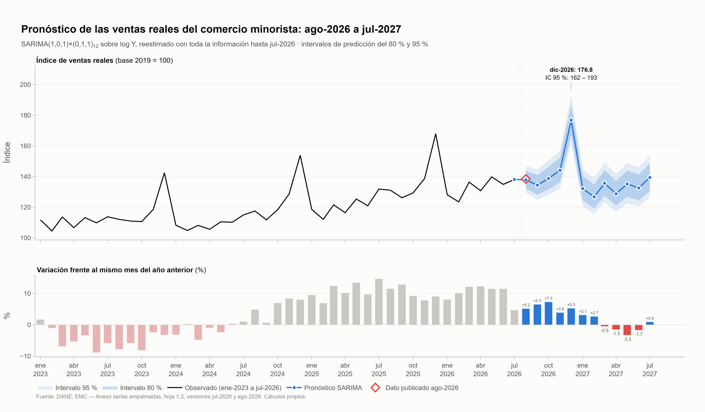

<div align="center">

# Pronóstico de las ventas reales del comercio minorista en Colombia

**Análisis comparativo de modelos de series de tiempo: Naïve estacional, SARIMA, Holt-Winters y Prophet**

[](https://colab.research.google.com/github/nvasquezc/Series_Tal2026/blob/main/notebooks/00_contexto_y_datos.ipynb)
[](https://www.python.org/)
[](https://docs.astral.sh/uv/)
[](https://www.statsmodels.org/)
[](https://facebook.github.io/prophet/)
[](https://plotly.com/python/)
[](https://www.dane.gov.co/index.php/estadisticas-por-tema/comercio-interno/encuesta-mensual-de-comercio-emc)
[](LICENSE)

</div>

---

**🎓 Institución:** Universidad Central · Maestría en Analítica de Datos
**📚 Curso:** Series de Tiempo · Periodo 2026-2 · Docente: Wilson Sandoval Rodríguez
**👨‍💻 Autores:** Jhon J. Ballén · David F. Orjuela · Néstor O. Vásquez

---

## 1. El problema

Cada diciembre el comercio minorista colombiano vende cerca de un **29 % más** de lo que indica su tendencia. Sobre esa expectativa se deciden compras de inventario, contratación temporal, cupos de crédito de consumo y la proyección del recaudo de IVA. Equivocarse en cualquiera de las dos direcciones cuesta: un inventario excesivo inmoviliza capital y uno corto deja ventas por fuera.

Este repositorio responde una pregunta concreta: **¿cuánto venderá el comercio minorista colombiano en los próximos doce meses, con qué incertidumbre, y qué modelo conviene usar para saberlo?** Para responderla se comparan tres modelos de la familia vista en el curso contra una referencia ingenua, bajo un protocolo de validación fijado de antemano.

## 2. Los datos

| Elemento | Definición |
|---|---|
| Fuente | DANE, Encuesta Mensual de Comercio (EMC), anexo «Series índices empalmados» |
| Variable | Hoja 1.2, columna «Total comercio minorista sin otros vehículos» |
| Unidad | Índice de ventas **reales** (descontada la inflación), base 2019 = 100 |
| Frecuencia y periodo | Mensual, enero de 2013 a julio de 2026 (163 meses, sin faltantes) |
| Partición | Entrenamiento: ene-2013 a jul-2025 (151 meses) · Prueba: ago-2025 a jul-2026 (12 meses) |
| Horizonte | 12 meses (agosto de 2026 a julio de 2027) |

El anexo se descarga desde el propio cuaderno. Se conservan dos versiones en `data/raw/`: la de **julio de 2026**, con la que se estiman todos los modelos, y la de **agosto de 2026**, que se usa solo para contrastar el primer mes pronosticado con el dato publicado.

## 3. Resultados principales

### Evaluación en el periodo de prueba (ago-2025 a jul-2026)

| Modelo | MAE | RMSE | MAPE | MASE | Cobertura IC 95 % | Meses que supera al Naïve |
|---|---:|---:|---:|---:|---:|---:|
| **SARIMA(1,0,1)×(0,1,1)₁₂** | **5,33** | **6,68** | **3,95 %** | **0,76** | 100 % | 11 / 12 |
| Holt-Winters (multiplicativo amortiguado) | 6,04 | 7,76 | 4,48 % | 0,86 | 100 % | 10 / 12 |
| Prophet (τ = 0,005) | 8,94 | 9,47 | 6,61 % | 1,27 | 67 % | 11 / 12 |
| Naïve estacional (referencia) | 12,32 | 12,58 | 9,14 % | 1,76 | 100 % | — |

### Estabilidad: MASE promedio en seis orígenes de pronóstico (backtesting)

| SARIMA | Prophet | Holt-Winters | Naïve estacional |
|:---:|:---:|:---:|:---:|
| **0,61** | 0,66 | 0,73 | 1,01 |

### Pronóstico final (SARIMA reestimado con los 163 meses)

| | Valor |
|---|---|
| Diciembre de 2026 | **176,8** · IC 80 %: 166,8 – 187,4 · IC 95 %: 161,7 – 193,2 |
| Variación frente a diciembre de 2025 | **+5,3 %** |
| Próximos 12 meses frente a los 12 anteriores | +2,3 % |
| Contraste con el dato publicado de agosto de 2026 | Real 138,44 · pronóstico 137,84 · error 0,44 % |

<p align="center">
  
</p>

### Lo que aprendimos

- **Los tres modelos superan al Naïve estacional**, tanto en la prueba como en cinco de los seis orígenes del *backtesting*. La complejidad adicional se justifica.
- **SARIMA es el modelo más confiable**: menor error en las cuatro métricas, el único con MASE < 1 en todos los orígenes, residuos sin autocorrelación y los intervalos más angostos sin perder cobertura.
- **Prophet es el más inestable**: el mejor en los años de *backtesting* y el segundo peor en la prueba. Funciona bien cuando las ventas crecen a su ritmo histórico y mal cuando aceleran.
- **Todos se equivocaron en la misma dirección**: el periodo de prueba creció cerca de 10 % y ningún modelo univariado lo anticipó. Los errores de SARIMA, Holt-Winters y Prophet tienen una correlación de 0,96 a 0,99; combinarlos no ayudaría. Mejorar el pronóstico exige información externa (tasas de interés, inflación, confianza del consumidor, calendario).

## 4. Estructura del repositorio

```
Series_Tal2026/
├── data/
│   ├── raw/                         Anexos originales del DANE (versiones jul-2026 y ago-2026)
│   └── processed/                   Serie limpia, partición, pronósticos y tablas de evaluación (CSV)
├── notebooks/
│   └── 00_contexto_y_datos.ipynb    Cuaderno único: del dato crudo al pronóstico final, paso a paso
├── reports/
│   └── figures/                     Figuras del cuaderno (PNG para documentos, HTML interactivo)
├── informe/
│   └── informe_ejecutivo.html       Informe ejecutivo interactivo (HTML + CSS, abrir en el navegador)
├── pyproject.toml · uv.lock         Entorno reproducible con uv
├── CITATION.cff                     Cómo citar este trabajo
└── LICENSE
```

### Recorrido del cuaderno

| Paso | Contenido | Figuras |
|---|---|---|
| 0 | Contexto, objetivo, descarga y limpieza del anexo del DANE | — |
| 1 | Exploración: tendencia (media móvil 2×12), estacionalidad, cambios estructurales y atípicos | `00_serie_componentes` |
| 2 | Preparación de la serie y partición temporal | `00_particion` |
| 3 | Naïve estacional, métricas (MAE, RMSE, MAPE, MASE) y tabla de resultados | `00_naive_estacional` |
| 4 | SARIMA: Box-Cox, pruebas ADF/KPSS/PP, ACF/PACF, intervenciones, búsqueda por AIC | `00_sarima_*` |
| 5 | Holt-Winters: cuatro configuraciones elegidas por *backtesting* | `00_hw_*` |
| 6 | Prophet: sensibilidad a `changepoint_prior_scale` y eventos | `00_prophet_*` |
| 7 | Pronósticos de prueba de los cuatro modelos | `00_pronosticos_prueba`, `00_errores_prueba` |
| 8 | Evaluación en la prueba y en seis orígenes | `00_evaluacion_*` |
| 9 | Diagnóstico de residuos de SARIMA y comportamiento de los errores | `00_diagnostico_sarima`, `00_errores_modelos` |
| 10 | Reestimación con toda la serie y pronóstico a 12 meses | `00_pronostico_final` |

Cada paso termina con una **lectura** que traduce el resultado estadístico a lo que significa para las ventas.

## 5. Cómo reproducir

Requiere [uv](https://docs.astral.sh/uv/getting-started/installation/) (Windows, macOS o Linux).

```powershell
git clone https://github.com/nvasquezc/Series_Tal2026.git
cd Series_Tal2026
uv sync                 # crea .venv con las versiones exactas de uv.lock
uv run jupyter lab      # abrir notebooks/00_contexto_y_datos.ipynb y ejecutar todo
```

- El cuaderno descarga el anexo del DANE si no está en `data/raw/` y regenera `data/processed/` y `reports/figures/`.
- Las figuras PNG se exportan con `kaleido`, que necesita Chrome o Chromium instalado. Si no lo encuentra, ejecute una vez `uv run plotly_get_chrome`; el cuaderno sigue funcionando y guarda la versión HTML de cada figura.
- **Google Colab:** use el botón del inicio. Instale primero `arch` y `kaleido` con `!pip install arch kaleido`.
- **Reproducibilidad:** las semillas están fijadas (`2026`). Prophet usa Stan, cuyos resultados pueden variar levemente según el sistema operativo; las cifras de este README corresponden a la ejecución en Windows.

### Informe ejecutivo

`informe/informe_ejecutivo.html` resume los resultados para tomadores de decisión, con gráficas interactivas. No requiere instalación: se abre directamente en el navegador.

## 6. Alcance y limitaciones

- Los modelos son **univariados**: solo usan la historia de las ventas. No incorporan tasas de interés, inflación, empleo ni confianza del consumidor.
- No se modelan efectos de **calendario** (Semana Santa, festivos, días sin IVA). En 2027 la Semana Santa cae en marzo, lo que puede desplazar ventas entre marzo y abril.
- Las cifras recientes del DANE son **provisionales** y se revisan cada mes. El pronóstico debe actualizarse con cada nueva publicación.
- La evaluación se apoya en 12 meses de prueba y seis orígenes: las diferencias pequeñas entre modelos no son concluyentes; las diferencias frente al Naïve sí lo son.

## 7. Fuente, cita y licencia

- **Datos:** DANE, Encuesta Mensual de Comercio (EMC). Información estadística pública, citada como *Fuente: DANE, EMC*.
- **Material del curso:** Sandoval Rodríguez, W. (2026). *Series de Tiempo* [repositorio]. <https://github.com/Wilsonsr/Series-de-Tiempo>
- **Cita de este trabajo:** ver [`CITATION.cff`](CITATION.cff).
- **Licencia:** el código se distribuye bajo licencia [MIT](LICENSE). Los datos pertenecen al DANE.
